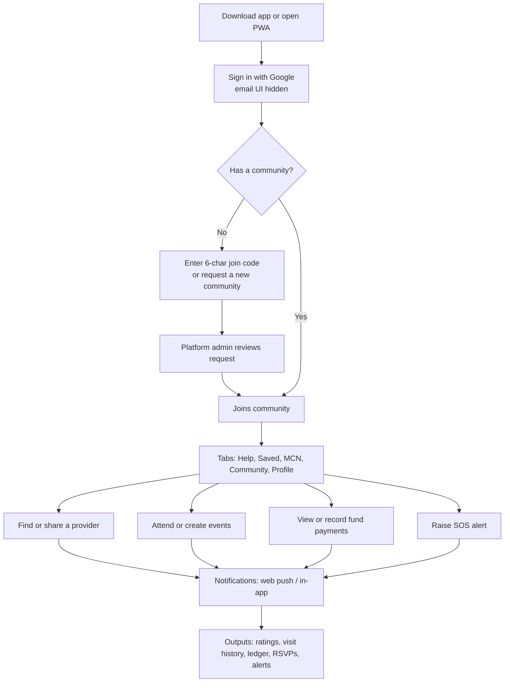
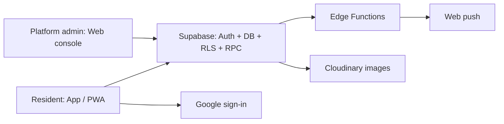
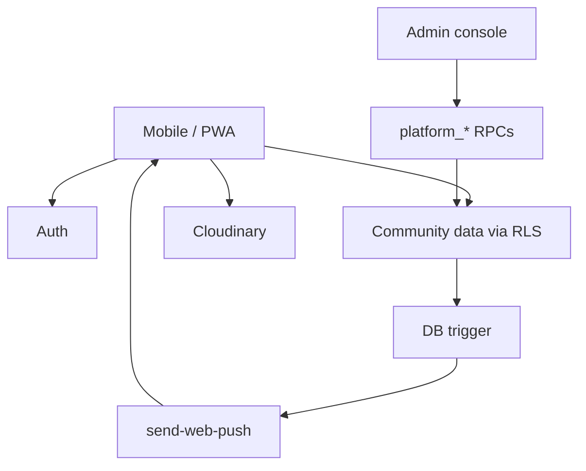
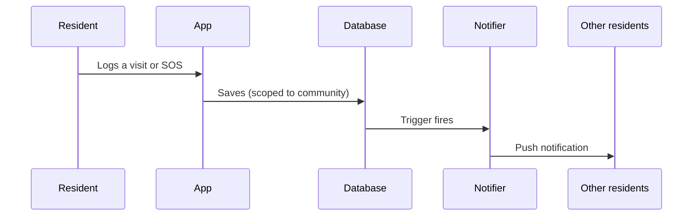

# Wooru: Product Analysis (360°)

**Scope:** Product, business, and workflow understanding of the Wooru repository (`D:\HanyaTech\Society_Service_Hub`).
**Basis:** The project's own documentation (`docs/`, `.github/app-summary.md`, `constants/featureFlags.ts`), cross-checked against git history (221 commits, clean working tree) and the Edge Function folder.
**Labels:** **[Fact]** = documented or evidenced in the repo. **[Assumption]** = inferred, not proven. **[Recommendation]** = advice.
**Not yet verified:** Most documented features were not re-checked in code. The type-check (`npx tsc --noEmit`) was not run because `npx` is not on the PATH.

---

## 1. Project Overview

**One-line:** Wooru is a private app that helps residents of a gated housing society find trusted service providers, share visit and rating information, and run community activity (events, funds, SOS alerts) in one place.

**One-minute version:** Gated housing societies have hundreds of families who need the same services: plumbers, maids, tutors, and so on. Today that knowledge lives in WhatsApp groups and word of mouth. Wooru creates a private, invitation-only space for each society. Residents join with a 6-character code. Inside, they see what neighbours have used and rated, can contact providers, and see the society's events, collections, and emergency alerts. Society office-bearers get tools to run it.

**Core idea:** Turn informal neighbourhood word-of-mouth into a structured, private, trusted directory scoped to one community.

**Surfaces [Fact]:** Mobile app (Android and iOS), an installable PWA from the same codebase, and a separate web platform admin console.

---

## 2. Problem Statement and Market Need

| Question | Answer |
|---|---|
| Problems | Provider choice is hit-and-miss; reviews are scattered across chats; society money and events are tracked on paper or spreadsheets; emergencies are coordinated by phone. **[Assumption from product design]** |
| Who has them | Residents (seekers), residents with good providers (sharers), society office-bearers (president, vice-president, treasurer). |
| Today's workaround | WhatsApp groups, notice boards, spreadsheets, phone calls. |
| Limitations | No privacy boundary, no memory (old recommendations vanish), no structure, no accountability for funds. |
| If it didn't exist | Knowledge stays in chat history and is lost; fund and event tracking stays manual. |
| Customer value | Faster, safer provider choices; transparent collections; faster emergency response. |

**Gap:** The repository contains no market research, competitor data, or sizing. Any market claim is **[Assumption]**.

---

## 3. Target Users and Stakeholders

| Category | Who | Expects | Pain today | Interaction | Benefit |
|---|---|---|---|---|---|
| Primary: Resident | Any society member | Quick, trustworthy provider answers | Unreliable referrals | Help, Saved, MCN, Community, Profile tabs | Shared memory of what works |
| Primary: Treasurer / collector | Residents with a fund role | Accurate per-flat collections | Spreadsheet errors | Fund screens inside Community | Transparent ledger |
| Secondary: Community lead | President or vice-president (identical powers) | Run events, approve members, see the whole picture | Coordination overhead | Community admin screens | Less admin work |
| Administrator: Platform admin | Wooru operator | Approve new communities, support, oversight | Manual onboarding | Web admin console only; blocked from mobile **[Fact]** | Controlled growth |
| Decision-maker | Society committee considering adoption | Privacy, low cost, easy rollout | Adoption risk | Demo, invite flow | Lower friction |
| Other stakeholders | Service providers; vendors (Supabase, Cloudinary, Google, Vercel) | Fair listings, reliable platform | Little visibility | Listings; vendor services | Customers from the community |

Provider-side expectations are not documented: **[Assumption]**.

---

## 4. Complete Product Workflow

**Numbered steps**
1. **Entry:** The resident opens the app or installed PWA and signs in with Google. **[Fact]**
2. **Community link:** If the user has no community, they enter a 6-character code or request a new community. **[Fact]**
3. **Approval:** New communities go to the platform admin for review. **[Fact]**
4. **Scoped session:** Every community screen loads data filtered by the user's community. **[Fact]**
5. **Use:** The resident browses providers, logs visits, rates, saves favourites, RSVPs to events, views funds, or raises SOS.
6. **Behind the scenes:** Database security rules check role and community on each read and write. Some events trigger notifications (web push through an Edge Function). **[Fact]**
7. **Outputs:** Ratings and hire feedback, visit history, fund ledger entries, RSVPs, SOS alerts.
8. **Finish:** No single end state. It is a continuous loop of use.

**Illustrative journey:** Meera moves into a 400-family society. She enters the join code from the security desk and signs in with Google. She searches "plumber," sees a provider her neighbour rated 5 stars, and logs a visit after the job. Later, she sees her maintenance collection status in Community. The treasurer recorded her payment against her flat.

---

## 5. Feature-by-Feature Explanation

| Feature | Class | What it does | Users | Depends on | If unavailable |
|---|---|---|---|---|---|
| Join by code / community | Core | Places a user in their society | All | Auth | No one can enter |
| Help: providers and visits | Core | Find, rate, log providers | Residents | Community scope, categories | Core value lost |
| Saved / favourites | Supporting | Personal shortlist | Residents | Providers | Minor inconvenience |
| MCN (My Community Network) | Core | Community-wide network hub; schools and Borrow & Share hidden | Residents | Providers, reminders | Loss of network view |
| Community events | Supporting | Events and RSVPs | Residents, leads | Community scope | Social coordination breaks |
| Funds ledger | Supporting / admin | Per-flat collections, treasurer ledger, other contributions | Treasurer, collector, residents | Flats, fund roles | Money tracking reverts to manual |
| SOS alerts | Core safety | Emergency broadcast | Residents, leads | Push notifications | Safety gap |
| Profile | Supporting | Account and settings | All | Auth | Limited |
| Web push (PWA) | Advanced | Alerts on the installed web app | Residents | `send-web-push` function, DB trigger | Alerts become in-app only |
| Platform admin console | Administrative | Approve communities, oversee | Platform admin | `platform_*` RPCs | No operator control |
| Due-service check | Advanced | Reminder logic (`check_due_services`) | Residents | Scheduler | Reminders not sent. Scheduling is partly blocked (see §12) |
| Fraud check | Advanced | `fraud-check` Edge Function | Platform | Data | Unknown; purpose inferred from name **[Assumption]** |

**Classification**
- **Core:** Join, Help, MCN, SOS.
- **Supporting:** Saved, Events, Funds, Profile.
- **Administrative:** Platform admin console, community lead tools, fund roles.
- **Advanced:** Web push, due-service reminders, fraud check.
- **Future / deferred / hidden:**
  - Cross-community federation: backend tables and RPCs exist; no screen uses them.
  - Phone OTP login: flagged off; `verify-phone-otp` function exists.
  - Schools catalog and Borrow & Share: hidden by flags.
  - Automatic visit-completion sweep: blocked, because `pg_cron` is not installed.
  - Business ordering: directory only; `mcn_orders` table remains.

---

## 6. Module and Component Responsibilities

| Module | Responsibility | Receives | Produces | Used by | Criticality |
|---|---|---|---|---|---|
| Auth and session | Sign-in and identity | Google login | Signed-in user with roles | All | Critical |
| Community scope | Keeps data within one society | User's community ID | Filtered data | All community features | Critical |
| Roles and permissions | Decides who can act | User role, fund role | Allow or deny | Community, Funds, Admin | Critical |
| Providers and visits | Directory, ratings, history | Provider data, visits | Ratings, history | Help, Saved, MCN | Critical |
| Funds ledger | Collections per flat | Payments, flats | Paid or unpaid status, totals | Community, treasurer | High |
| Events | Schedules and RSVPs | Event data | Attendance | Community | Medium |
| SOS | Emergency alerts | Alert trigger | Notifications | Push | High (safety) |
| Notifications | Push and in-app | Database events | Messages | Many | High |
| Platform admin | Approvals and oversight | Community requests | Decisions | Community creation | High |
| Admin console | Web UI for operator | Read-only RPC data | Views and actions | Platform RPCs | Medium |
| Cloud media | Image storage | Uploads | Image URLs | Providers, profiles | Medium (replaceable) |

---

## 7. System Architecture (Conceptual)

**Analogy:** Wooru is a gated society's front office. The app is the reception desk, the database is the register, the security rules are the gatekeepers, and the notification service is the intercom.

**Components**
- **User-facing:** Expo / React Native app (mobile and PWA); vanilla-JS admin console.
- **Business processing:** Database functions (RPCs) and security rules, close to the data.
- **Data:** Supabase (Postgres, auth, realtime, functions).
- **External:** Cloudinary (images), Google sign-in, Vercel (hosting), Supabase email (dev-only, rate-limited).
- **Background:** Edge Functions `send-web-push`, `check_due_services`, `fraud-check`, `verify-phone-otp`. A database trigger calls push.
- **Security boundaries:** Community scope, role checks, platform admin separate from community leads, admin console reads only through protected functions.
- **Deployment:** Vercel (web), app stores (mobile), Supabase cloud (backend).

**Diagram 1: High-level architecture**

**Diagram 2: Component interaction**

**Diagram 3: Data flow for one event**

---

## 8. Data and Information Flow

| Question | Answer |
|---|---|
| Enters the system | Profiles, visits, ratings, RSVPs, payments (residents); events and notices (leads); community approvals (platform admin); listings (providers) |
| Origin | Mostly typed by users; images go to Cloudinary |
| Processing | Checked against roles and community scope inside the database |
| Storage | Supabase Postgres; about 191 migrations from 2026-04 to 2026-10 **[Fact, by file count]** |
| Retrieval | Queries filtered by community and user |
| Between modules | Via database, triggers, and Edge Functions |
| Visibility | Residents see their community's data, except private items (saved, personal notes, own service history). Leads see more. Platform admin sees platform data through protected functions. |

**Example journey:** A resident rates a plumber → rating saved with community ID → provider average updates in Help → neighbours see it → optional push notification.

---

## 9. Business Logic and Decision-Making

| Decision | Conditions | Pass | Fail | Automated? |
|---|---|---|---|---|
| Who sees a community's data | Membership and community ID | Data shown | Hidden or empty | Automated (database rules) |
| Who acts as a lead | Role is president or vice-president | Lead tools | Resident view | Automated |
| Fund payment status | One general contribution per flat per fund | Marked paid | Unpaid | Treasurer enters (human) |
| Treasurer | Exactly one per fund | Allowed | Blocked | Automated |
| Community creation | Platform review | Activated | Rejected | Human (platform admin) |
| Reminders | Due-date check | Push sent | None | Automated, partly blocked |

**Exceptions**
- "Other contributions" are free text, count toward totals, and are not tied to a flat.
- Admin console empty views can mean a blocked read, not missing data. Direct table reads silently return empty; reads must go through `platform_*` RPCs. **[Fact, per docs]**

---

## 10. User Experience and Product Journey

- **Screens:** Five tabs: Help, Saved, MCN, Community, Profile. **[Fact]**
- **Users can:** Search providers, rate, log visits, save favourites, RSVP, view funds, raise SOS, manage the community (leads).
- **Navigation:** Forward uses push; back uses a smart-back function; never replace history. **[Fact, per conventions]**
- **Design:** "Verandah" system: light mode, flat surfaces, no shadows. **[Fact]**

**Confusion and usability risks**
- Email login is hidden, so only Google sign-in works. Users without a Google account may be stuck. **[Fact]**
- Hidden features (schools, Borrow & Share) may be expected by users who saw older materials.
- Fund roles (treasurer, collector) differ from community roles, which can confuse users.
- Admin console empty states look like missing data.
- Join codes must be shared offline. No in-app onboarding guide was found. **[Assumption]**

---

## 11. Integrations and Dependencies

| Dependency | Why | If it fails | Replaceable? |
|---|---|---|---|
| Supabase (DB, auth, functions) | Core platform | App unusable | Hard |
| Google sign-in | Login | No login | Medium |
| Cloudinary | Images | Photos missing | Yes |
| Vercel | Web hosting | PWA and admin console down | Yes |
| Web push service | Alerts on web | Alerts lost; in-app remains | Medium |
| Supabase SMTP email | Verification mail | Verification fails (dev-only, rate-limited) | Yes, needs production SMTP |
| Expo / app stores | Mobile distribution | No install | Hard |

---

## 12. Current Project Status

**Evidence:** Git history (221 commits, clean working tree; recent commits on funds, bug fixes, and docs); about 191 migrations; four Edge Functions; feature flags; docs. Not all verified in code.

| Status | Items |
|---|---|
| Completed and working (per docs and commits) | Join by code, Help providers and visits, funds ledger, PWA push (live 2026-08-17), email verification re-enabled 2026-08-08 |
| Implemented, needs validation | "Other contribution" fund flow (recent commits), due-service reminders, fraud check, admin console |
| Partially implemented | MCN (schools and Borrow & Share hidden), cross-community (backend only), business ordering (directory only) |
| Planned, not implemented | Automatic visit-completion sweep, phone OTP login (flagged off), production SMTP, preprod environment |
| Missing or not identified | Automated tests, lint script, in-app user onboarding, market research, provider onboarding, privacy policy (not in repo) |
| Blocked or external | `pg_cron` not installed (blocks sweep); SMTP provider; preprod Supabase project (placeholder); app-store releases (not verified) |

**Documentation drift:** `.github/app-summary.md` §14 lists `npm run db:push`, but the ops docs say there is no unsuffixed push. Treat the operational docs as correct.

**Open checks:** Type-check not run (`npx` not on PATH). `docs/features.md` and `docs/architecture.md` not yet read.

---

## 13. Strengths, Weaknesses, Risks and Gaps

**Product strengths**
- Clear private-community focus; trust model scoped to one society.
- Clean role separation and documented rules.

**Architectural strengths**
- Security enforced in the database, not only in the app.
- Feature flags allow safe hiding; documented "hidden, not deleted" rule.

**Business weaknesses**
- No documented revenue model or market evidence.
- Heavy dependence on a single backend vendor.

**Risks, by severity**
1. **High:** Resident data privacy across communities. The hard-coded platform admin email and "break-glass" path are documented but not verified in code; they are sensitive.
2. **High:** Single-vendor dependency on Supabase for data, auth, and functions.
3. **High:** Money tracking (funds) has no automated tests and was recently restructured. Errors would damage trust.
4. **Medium:** Email delivery depends on dev-only SMTP; sign-up can fail at scale.
5. **Medium:** No automated tests. The only gate is type-checking.
6. **Medium:** Google-only sign-in narrows the audience.
7. **Low:** Documentation drift (§14 `db:push`).

**Scalability:** Each community is a tenant. Growth depends on indexing and row-level security performance. Not measured. **[Assumption]**

---

## 14. Competitive Advantage and Business Value

**Proven (repo evidence)**
- Community-scoped directory with ratings and visit history.
- Fund ledger designed for per-flat accounting.
- Live PWA push.

**Assumptions (not proven)**
- Residents prefer this to WhatsApp groups.
- Societies will pay.
- Providers want listings.

**Possible monetization (assumption):** Per-society subscription; committee features; provider listing or lead fees (sensitive, since ordering is hidden); sponsored notices.

**Hard to replicate:** A per-society trust graph built from real visits and ratings. It only becomes valuable after adoption.

---

## 15. Real-World Scenarios

| # | Situation | User | Problem | How Wooru helps | Result | Value |
|---|---|---|---|---|---|---|
| 1 | Plumber needed at 9 pm | Resident | Unknown reliable provider | Help shows a neighbour's recent 5-star rating | Calls the provider | Time saved, safer pick |
| 2 | Monthly maintenance collection | Treasurer | Spreadsheet errors | Records payments per flat in the ledger | Clear unpaid list | Transparency |
| 3 | Emergency at the gate | Resident | Slow coordination | SOS alert pushes to neighbours | Faster response | Safety |
| 4 | New society rollout | Committee and platform admin | Trust and control | Join request reviewed by admin | Controlled activation | Quality |
| 5 | Society picnic | Lead | Headcount unclear | Event with RSVPs | Attendance known | Better planning |
| 6 | Resident moves out | Departing and incoming residents | Losing recommendations | Community data stays; new resident joins by code | Continuity | Retained knowledge |

Scenarios 2 to 5 depend on features whose completeness is only partly verified.

---

## 16. Future Scope and Improvement Opportunities

**Immediate priorities**
1. Make production email and sign-up reliable.
2. Add automated tests for funds and security rules.
3. Fix documentation drift (§14 `db:push`) and confirm deploy commands.
4. Decide on hidden features: restore or remove.

**Long-term**
- Cross-community federation (backend exists).
- Preprod environment and monitoring.
- Enterprise readiness: audit logs, SSO, data export and deletion policies.
- Reminder automation once `pg_cron` or an alternative is available.
- Provider onboarding and a monetization model.

---

## 17. Final Project Understanding

1. **What are we building?** A private, invitation-only app for gated residential societies covering providers, community activity, funds, and safety.
2. **Why?** Trusted local knowledge and community admin are fragmented across chats and paper.
3. **Who uses it?** Residents, office-bearers and treasurers, and a platform operator.
4. **Problem solved?** Finding trusted providers, transparent collections, coordinated community action.
5. **How it works:** Residents join by code and use community-scoped tabs. The database enforces who sees what. Notifications and admin tools surround it.
6. **Most important features:** Provider directory with ratings, community join, funds ledger, SOS, events.
7. **Value:** Trust, time saved, transparency.
8. **Completed:** Core community, directory, funds ledger (recently reworked), PWA push, email verification.
9. **Remaining:** Validation of funds and admin, reminders, tests, production SMTP, preprod, decision on hidden features.
10. **Biggest risks:** Data privacy, single-vendor dependency, untested money flows, weak email delivery.
11. **Next three priorities:** (a) validate funds and security rules with tests; (b) production email and sign-up; (c) decide on hidden features and clean up doc drift.

---

## 18. Knowledge Validation: Question Bank

### A. Understanding (20)
1. What is Wooru in one sentence? *Private, invitation-only app for gated-society residents to find providers and run community activity.*
2. Who is the primary user? *Residents of a gated society.*
3. Why does a society need a join code? *It keeps the community private and scoped.*
4. What are the five tabs? *Help, Saved, MCN, Community, Profile.*
5. What is a "community" in this product? *A tenant: one society's data, isolated from others.*
6. Why is "scoped by community" important? *It prevents data leaking between societies.*
7. What is the difference between `president` and `resident`? *Presidents act as community leads with management tools.*
8. Do `president` and `vice_president` differ in power? *No; they have identical powers.*
9. What is a platform admin? *Wooru operator who approves communities via the web console.*
10. Can a platform admin use the mobile app? *No; they are redirected to the web console.*
11. What is a fund role? *A per-fund role such as treasurer or collector, separate from community roles.*
12. How many treasurers per fund? *Exactly one.*
13. What is an "other contribution"? *Free-text income not tied to a flat; counts toward totals.*
14. What do the flags hide? *Schools catalog, Borrow & Share, and the "most ordered" sort.*
15. Why is email login hidden? *Product choice; only Google sign-in is shown.*
16. What is the PWA? *The same app installed from the browser, with web push.*
17. What does "hidden, not deleted" mean? *Code and data remain; the UI is switched off by a flag.*
18. What is federation? *Cross-community sharing; backend exists, no UI yet.*
19. What is the single validation gate? *Type-checking (`npx tsc --noEmit`).*
20. What is generated and must never be hand-edited? *`lib/database.types.ts`.*

### B. Scenario-based (10)
1. A resident needs a plumber at night. Where do they start? *Help tab; search and check ratings.*
2. A resident pays maintenance. Who records it? *The treasurer, against the flat.*
3. A flat has two general payments for one fund. What happens? *Rule: one general contribution per flat per fund.*
4. A resident raises SOS. Who is notified? *Community members via push (and in-app).*
5. A new committee wants Wooru. What is the first step? *Submit a community request for platform review.*
6. An admin opens an empty view in the console. What might be wrong? *A blocked read; direct reads return empty.*
7. The schools feature is missing. Why? *Hidden by a flag, not deleted.*
8. A resident without Google wants to join. Problem? *Email login is hidden, so they are blocked.*
9. A visit-completion sweep is expected. Why isn't it running? *`pg_cron` is not installed.*
10. Email verification fails for many users. Likely cause? *Dev-only, rate-limited Supabase SMTP.*

### C. Stakeholder questions (10)
1. Is my society's data visible to other societies? *No; scoped by community.*
2. Who can see my payment? *The treasurer and fund roles; leads per the rules.*
3. Is this free? *Not documented; monetization is an assumption.*
4. Does it work on iPhone? *Mobile app targets iOS; store releases not verified.*
5. How quickly does an SOS reach people? *Push is live on PWA; speed not measured.*
6. Who controls my data? *Supabase-hosted; policy not in repo. Needs confirmation.*
7. What if the vendor goes down? *Whole app is affected; single-vendor risk.*
8. Can I export my data? *Not documented.*
9. Who approves our community? *The platform admin.*
10. Can providers pay to be listed? *Not documented; ordering is hidden.*

### D. Product manager and architect questions (10)
1. What is the riskiest unverified feature? *Funds ledger; no automated tests.*
2. Why is security in the database? *So rules hold even if the app is bypassed.*
3. What is the biggest architectural risk? *Single-vendor dependency on Supabase.*
4. What is the documentation drift? *App summary §14 lists an unsuffixed `db:push`.*
5. How do you safely release a hidden feature? *Flip the flag after validation; keep docs in sync.*
6. What blocks reminder automation? *`pg_cron` not installed.*
7. What must happen after a migration? *Push to prod, regenerate types, run `tsc`.*
8. How would you measure adoption? *Not instrumented in the repo; needs analytics.*
9. What is the next priority? *Tests for funds and security rules.*
10. What should be decided on hidden features? *Restore or remove; set a deadline.*

---

## Open items
- Type-check not run (`npx` not on PATH). Node must be on the PATH.
- `docs/features.md` and `docs/architecture.md` not yet read.
- Most features not re-verified in code; §12 status is documentation-based.
- Documentation drift in `.github/app-summary.md` §14.
